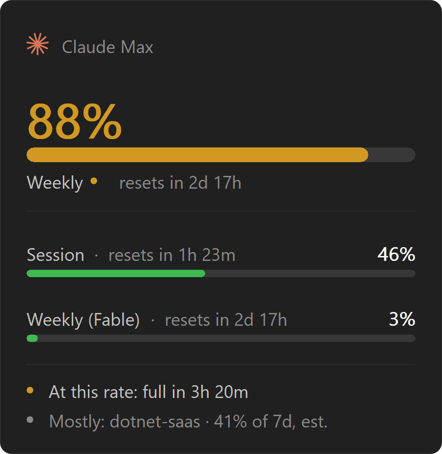

<div align="center">


# Cota

Your Claude usage limits, in the tray — a ring that fills as your week does.

<sub><i>cota</i> — Portuguese for <i>quota</i></sub>



</div>

Claude Code shows your limits when you ask it (`/usage`). Cota shows them when
you didn't: a ring in the tray that turns amber at 75% and red at 90%, so you
notice the wall before you hit it.

A single ~1 MB binary, no runtime dependencies. Idles at about 5 MB of RAM and
no measurable CPU.

## The interface

| | |
|---|---|
| **Ring** | Fills with whichever limit is closest to its ceiling. Green → amber → red. |
| **Panel** (left-click) | The fullest limit large and in colour, the rest as compact bars. |
| **Menu** (right-click) | The commands. |
| **Projection** | *At this rate: full in 3h 20m*, from the slope of your own usage. |
| **Attribution** | Which project ate the week, read from local transcripts. |
| **Toasts** | At 50/80/95%, once each per limit per window — and when a limit you were near resets. |

The panel is painted from the last reading and never touches the network, so
opening it is instant. Cota never polls more than once every 10 seconds; a
refresh inside that window replays the last reading and tells you how old it is.

Running `cota` again while it's already in the tray makes the running instance
toast its numbers instead of starting a second copy.

## Install

### Windows

```powershell
winget install kidchenko.Cota
# or
choco install cota
```

Or grab [**Cota-Setup.exe**](https://github.com/kidchenko/cota/releases/latest/download/Cota-Setup.exe)
directly. Each release also ships a portable `cota-x.y.z-x64.exe` that runs
without installing — see [Releases](https://github.com/kidchenko/cota/releases).

The binary isn't code-signed, so SmartScreen warns on first run: click **More
info → Run anyway**. Prefer the installer if you want toasts to read "Cota" —
Windows takes a notification's name from a Start Menu shortcut, and only the
installer creates one. A portable copy borrows PowerShell's identity instead.

### macOS

Download [**Cota.dmg**](https://github.com/kidchenko/cota/releases/latest/download/Cota.dmg)
(Apple silicon), open it, and drag Cota into **Applications**. It lives in the
menu bar with no Dock icon.

The build isn't notarized, so Gatekeeper blocks the first launch. Clear it once:

- **System Settings → Privacy & Security → Open Anyway** next to Cota; or
- `xattr -dr com.apple.quarantine /Applications/Cota.app`

Move it into Applications *first* — the quarantine flag can't be cleared while
the app is still on the read-only disk image.

### Requirements

Claude Code, signed in at least once on this machine. Cota reads the token
Claude Code already stores and never asks for a credential of its own.

## Where the numbers come from

**Limits** come from `GET https://api.anthropic.com/api/oauth/usage` — the same
endpoint `/usage` reads. It's undocumented and may change without notice.

**Projection** is fitted from Cota's own samples of the reported percentage over
time, not from counting local tokens. Subscription buckets weight cache reads,
model tier and effort differently, and none of those weights are published — so
the slope of the percentage is honest where a local token count can't be.

**Attribution** reads `~/.claude/projects/**/*.jsonl`, weights tokens by the
published Opus price ratios, and reports a *share between projects*. It's an
estimate, labelled as one — treat it as "where did the week go", not a share of
any limit.

## Configuration

`%APPDATA%\Cota\config.json`, created on first save. Edits are picked up within
a poll — no restart.

```json
{
  "enabled": true,
  "pollSeconds": 60,
  "thresholds": [50, 80, 95],
  "notify": true,
  "userAgent": "claude-code/2.1.236",
  "projection": true,
  "attribution": true
}
```

`pollSeconds` is clamped to 20–900. `userAgent` isn't cosmetic — the endpoint
rate-limits hard without a `claude-code/...` agent string, and it's here so it
can be bumped without a rebuild.

## Credentials

Claude Code stores its OAuth token in a plain JSON file at
`~/.claude/.credentials.json` on Windows, and in the login Keychain (service
`Claude Code-credentials`) on macOS. Cota reads whichever applies and sends the
token only to `api.anthropic.com` — the service that issued it, and the only
host Cota ever contacts.

It doesn't cache the token or refresh OAuth; Claude Code already does that, so
re-reading the file each poll avoids two processes racing to spend one
single-use refresh token. `CLAUDE_CONFIG_DIR` is honoured if you've moved that
directory. TLS goes through the OS trust store, so an intercepting corporate
proxy works where a bundled root set wouldn't.

## When it breaks

The endpoint is a live experiment surface, so Cota is built to survive it:
every field is optional, unknown keys are ignored, and the newer `limits[]` array
falls back to the older `five_hour` / `seven_day` objects if it vanishes. Server
`severity` is trusted but never relied on — Cota takes the worse of what the
server says and what the percentage implies.

When it does break, the icon goes to a grey dashed ring and the menu says why.
Set `COTA_LOG=debug` and the full response lands in `%APPDATA%\Cota\cota.log`.

## Build

```powershell
.\build.ps1              # test + release binary
.\build.ps1 -Run         # ... then launch it
.\build.ps1 -Panel       # ... hold the panel on screen to inspect it
.\build.ps1 -Shot        # ... re-render docs\img\panel.png
```

```bash
./build.sh               # test + release binary + Cota.app
./build.sh --run         # ... then launch it in the menu bar
./build.sh --dmg         # ... wrap Cota.app in a .dmg
```

Needs only the Rust toolchain — no WebView2, no installer tooling. The ring and
panel layout are shared Rust; only the OS-specific pieces fork (GDI vs AppKit,
file vs Keychain, WinRT vs `osascript`).

## Not yet

- **A signed, notarized macOS build** — would drop the Gatekeeper warning and let
  toasts carry Cota's own name.
- **A history view** — the samples are already on disk in `state.json`.

## License

MIT.
